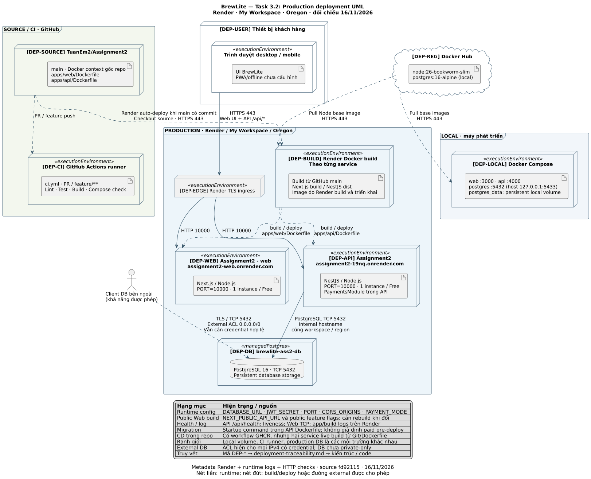

# Task 3.2 — UML deployment diagram production

## 1. Nền tảng thực tế và phạm vi

Đối chiếu ngày **16/11/2026** với **My Workspace** trên Render. Web, API và PostgreSQL thuộc cùng workspace, cùng region **Oregon**. Hai dịch vụ Web/API đang dùng **Docker runtime, build từ GitHub nhánh main**; không phải image-backed service pull từ GHCR.

Source đối chiếu: commit `fd9211599033519c7e96c60bf8ff26a4b0325b33`. Render cũng ghi nhận hai deployment live từ commit này tại thời điểm kiểm tra. [Bằng chứng chi tiết](deployment-evidence.md) phân biệt metadata Render, log runtime và kiểm tra HTTP.

[Nguồn PlantUML](deployment-production.puml) — [Truy vết node và đối chiếu yêu cầu](deployment-traceability.md) — [Kiến trúc Task 3.1](../../architecture/task3.1-architecture.md).

## 2. Thành phần đang sử dụng

| Thành phần | Cấu hình thực tế |
| --- | --- |
| Thiết bị người dùng | Trình duyệt desktop/mobile; frontend có trong `apps/web`. Source chưa có manifest/service worker nên không coi PWA/offline là đã hoàn thiện. |
| Frontend | Render Web Service **Assignment2 - web**, `srv-dbso1gm7bikc73c0h2r0`, <https://assignment2-web.onrender.com>, Dockerfile `apps/web/Dockerfile`, plan Free, 1 instance. |
| Backend | Render Web Service **Assignment2**, `srv-dbsnuf1srm7s73dsl390`, <https://assignment2-19nq.onrender.com>, Dockerfile `apps/api/Dockerfile`, plan Free, 1 instance. |
| Database | Render PostgreSQL **brewlite-ass2-db**, `dpg-dbsmrami0phs73dj58q0-a`, PostgreSQL 16, plan Free, status available. Dữ liệu lưu trong storage của dịch vụ database, tách filesystem của Web/API. |
| Build và phát hành | Render theo dõi GitHub `TuanEm2/Assignment2`, branch `main`; auto-deploy bật, trigger `commit`; Docker context là gốc repo. |
| Container registry đang liên quan đến build | Docker Hub cung cấp base image `node:26-bookworm-slim` cho cả hai Dockerfile. Local Compose còn dùng `postgres:16-alpine`. Image ứng dụng được Render build và triển khai. |
| CI | GitHub Actions chạy lint/test/build và kiểm tra Compose trên PR/feature branches. Runner không chạy app/database production thường trực. |
| Mock payment | Module logic trong tiến trình NestJS API; không có một container payment riêng. Mode mock/PayOS phụ thuộc env, không suy ra mode đang bật từ `.env.example`. |

Frontend được phục vụ bằng Next.js server trên Render Web Service. Không thêm một CDN độc lập hoặc Nginx container vào sơ đồ khi không có bằng chứng chúng được cấu hình.

## 3. Luồng source, build và deploy

1. Developer làm việc ở local, gửi PR; GitHub Actions kiểm tra lint/test/build.
2. Sau khi commit xuất hiện trên `main`, Render tự deploy hai service theo cấu hình `autoDeployTrigger=commit`.
3. Render lấy source từ GitHub, build từng service bằng Dockerfile tương ứng và pull base image Node từ Docker Hub qua HTTPS.
4. Dockerfile Web tạo Next.js build; Dockerfile API sinh Prisma client và build NestJS.
5. Render chạy image do hệ thống build, cấp HTTPS ingress và chuyển lưu lượng tới cổng ứng dụng.
6. API dùng Prisma/PostgreSQL; log startup ghi nhận hostname DB nội bộ `dpg-dbsmrami0phs73dj58q0-a`.

**Phân biệt với workflow có trong repo:** `.github/workflows/cd.yml` còn định nghĩa một đường CD qua GHCR và Render API. Hai service live được đọc từ Render là Git/Dockerfile-backed, không cấu hình pull image GHCR. Vì vậy, sơ đồ không vẽ luồng GHCR → production là luồng đang hoạt động. Việc một workflow tồn tại không chứng minh nó kiểm soát production.

Render hiện deploy theo commit, không cấu hình “chờ CI thành công” ở mức service. Quy trình nhóm cần merge PR sau CI đạt; push trực tiếp lên main có thể kích hoạt Render mà không qua quy trình PR.

## 4. Giao thức, cổng và ranh giới mạng

| Kết nối | Giao thức / cổng | Bằng chứng / phạm vi |
| --- | --- | --- |
| Browser → Web | HTTPS 443 | Web/menu trả HTTP 200 trên `assignment2-web.onrender.com`. |
| Browser → API | HTTPS 443 | `assignment2-19nq.onrender.com/api/*`; JWT cho route cần xác thực. CORS đã trả đúng Web origin. |
| Render ingress → Next.js | HTTP **10000** | Log Next.js `localhost:10000` và log Render phát hiện cổng. Không phải public URL `:10000`. |
| Render ingress → NestJS | HTTP **10000** | Log Render phát hiện cổng 10000; `main.ts` đọc `PORT`. Fallback 4000 trong source không phải cổng live được quan sát. |
| API → PostgreSQL | PostgreSQL TCP **5432**, hostname nội bộ | Log Prisma datasource ghi hostname ngắn `dpg-dbsmrami0phs73dj58q0-a`; cùng account/region. Không khẳng định SSL mode nội bộ khi chưa đọc cấu hình đó. |
| Client DB ngoài Render → PostgreSQL | TLS/TCP **5432**, được cấu hình cho phép | `ipAllowList=0.0.0.0/0`; vẫn cần credential hợp lệ. Đây là khả năng truy cập được cho phép, không phải bằng chứng có client ngoài đang kết nối. |
| Render build → GitHub / Docker Hub | HTTPS **443** | Source Git và các lệnh FROM trong Dockerfile. |
| Local host → local stack | Web 3000, API 4000, DB host 5433 | Compose bind `127.0.0.1`; PostgreSQL container dùng 5432. |

**Hiện trạng database:** API có đường nội bộ, nhưng database **chưa được khóa external access**: allow list hiện cho phép mọi IPv4 có credential hợp lệ. Sơ đồ thể hiện cả đường nội bộ và khả năng truy cập ngoài. Việc đóng external access là thay đổi vận hành riêng; lần cập nhật tài liệu này không thay đổi ACL.

## 5. Persistent storage và migration

PostgreSQL là dịch vụ managed có storage lưu dữ liệu bền vững, không phải dữ liệu đặt trong container API hay volume Compose của máy phát triển. Không ghi một dung lượng, backup schedule hoặc HA không được metadata xác nhận; database hiện không bật HA.

Local Compose dùng named volume `postgres_data`. API local mặc định chạy `npm run db:migrate` khi startup. Dockerfile API có cùng lệnh startup có điều kiện theo `RUN_MIGRATIONS_ON_STARTUP`; log service live có dòng Prisma datasource tới DB nội bộ.

Không mô tả paid pre-deploy migration là bước đang được dùng trên hai service Free. Pre-deploy trong workflow GHCR là một hợp đồng cho đường phát hành khác trong source. Rollback image/source không tự đảo ngược migration hay dữ liệu đã ghi.

## 6. Secret, environment variables, health và log

| Nơi sử dụng | Tên cấu hình | Trách nhiệm |
| --- | --- | --- |
| API runtime | `DATABASE_URL`, `JWT_SECRET`, `PORT`, `CORS_ORIGINS`, `PAYMENT_MODE` | Kết nối DB, xác thực, listen port, CORS và mode thanh toán. Chỉ ghi tên biến, không ghi giá trị bí mật. |
| API nếu bật PayOS | `PAYOS_ENABLED`, `PAYOS_CLIENT_ID`, `PAYOS_API_KEY`, `PAYOS_CHECKSUM_KEY`, `WEB_PUBLIC_URL` | Cổng cấu hình cho tích hợp riêng; không coi nó là một mock-payment container. |
| Web build | `NEXT_PUBLIC_API_URL`, các public feature flags | Dữ liệu công khai trong bundle; thay đổi cần rebuild. |
| CD GHCR có trong repo | `RENDER_API_KEY`, service IDs, public URLs | Chỉ liên quan đường CD được định nghĩa trong workflow; không phải bằng chứng cấu hình runtime live. |

- API có **Health Check Path `/api/health`** trong metadata Render; GET đã trả 200 với contract `status/service/timestamp`. Đây là liveness, không phải kiểm tra DB.
- Web không cấu hình HTTP health-check path; nền tảng dùng kiểm tra TCP mặc định.
- GET catalog đã trả JSON 4 sản phẩm, kiểm tra được đường đọc dữ liệu của API ở thời điểm gọi.
- Log app/build của hai service có thể đọc trên Render; đã dùng log để đối chiếu datasource và cổng 10000. NestJS/Next.js ghi stdout/stderr.
- Chưa có bằng chứng về hệ thống log tập trung riêng, request ID thống nhất, readiness DB đầy đủ hoặc cảnh báo SLO; không thêm chúng vào sơ đồ như thành phần đã triển khai.

## 7. Kết quả đối chiếu yêu cầu

Bộ sơ đồ thể hiện đủ: browser; Next.js service; NestJS service; PostgreSQL/persistent storage; registry và nền tảng build/deploy; HTTPS/private path/cổng; env/secret/health/log; ranh giới local, CI và production. [Bảng truy vết](deployment-traceability.md) ánh xạ từng node và từng container local tới kiến trúc và source cụ thể.

Deployment đã được đối chiếu với nền tảng thật thay vì chỉ suy ra từ Docker Compose/CD mẫu. Kết luận này áp dụng cho **nội dung deployment diagram và khả năng truy vết**, không xác nhận toàn bộ NFR, bảo mật, tải chịu đựng hay E2E của ứng dụng. External DB access ở mục 4 là một điểm vận hành còn mở cần nhóm theo dõi.
