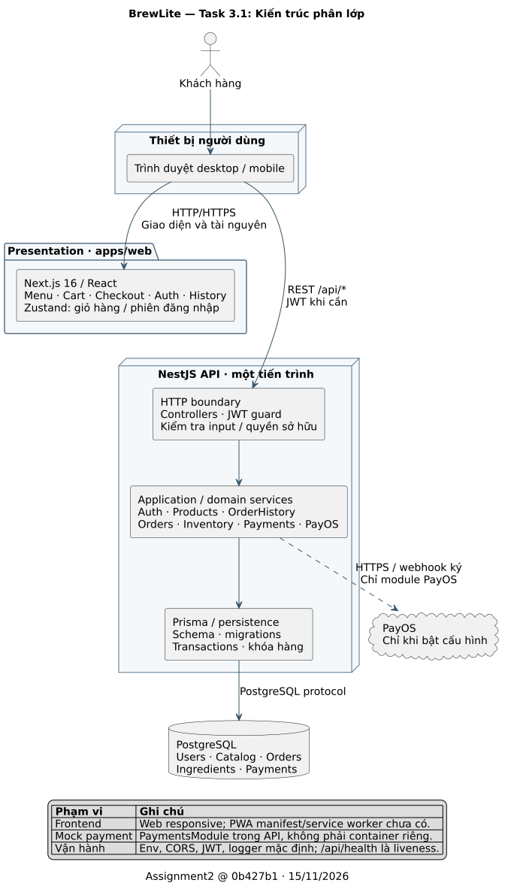

# Task 3.1 — Phương pháp và quyết định kiến trúc

## 1. Phạm vi và phương pháp

BrewLite là ứng dụng đặt đồ uống: khách xem sản phẩm, chọn size/topping, quản lý giỏ hàng, đăng nhập, đặt đơn, thanh toán và xem lịch sử đơn. Nhóm mô tả hệ thống bằng **kiến trúc phân lớp**, kết hợp góc nhìn container để xác định ranh giới giữa trình duyệt, frontend, API và cơ sở dữ liệu.

Tài liệu đối chiếu mã nguồn Assignment 2 tại commit `0b427b1e54b249addfd0229c406fd5ad62cb0ef2`, ngày 15/11/2026. “Đang có” nghĩa là có bằng chứng trong source; trạng thái dịch vụ production được ghi riêng trong [Task 3.2](../diagrams/task3.2/task3.2-deployment.md).

Nguồn sơ đồ chỉnh sửa được: [layered-architecture.puml](layered-architecture.puml).

## 2. Các lớp và trách nhiệm

| Lớp | Thành phần | Trách nhiệm và ranh giới |
| --- | --- | --- |
| Thiết bị người dùng | Trình duyệt desktop/mobile | Hiển thị giao diện, gửi HTTPS request và giữ trạng thái giao diện. Không truy cập PostgreSQL trực tiếp. |
| Presentation | Next.js 16, React, Zustand trong `apps/web` | Menu, chi tiết sản phẩm, giỏ hàng, đăng ký/đăng nhập, checkout và lịch sử đơn. Gọi REST API với JWT cho chức năng cần xác thực. |
| HTTP/API | NestJS controllers, JWT guard | Tiếp nhận request, kiểm tra dữ liệu/định danh, giới hạn thao tác theo người dùng và chuyển cho service. API dùng tiền tố `/api`. |
| Application/domain | NestJS services theo module | Tính giá theo dữ liệu backend, áp dụng state machine đơn hàng, giữ/hoàn nguyên liệu, xử lý thanh toán và idempotency. |
| Persistence | Prisma và PostgreSQL | Lưu người dùng, sản phẩm, đơn hàng, nguyên liệu và thanh toán; thực thi transaction, khóa và ràng buộc unique. |
| Vận hành | Docker, GitHub Actions, Render | Đóng gói, kiểm thử, phát hành, cấu hình môi trường, health check và thu thập log tiến trình. |

Frontend và backend là hai tiến trình triển khai riêng. Backend là **modular monolith**: các module chạy chung trong một NestJS API, không phải mỗi module là một microservice.

### 2.1 Frontend Next.js và định hướng PWA

Next.js phục vụ giao diện qua HTTP/HTTPS. Các phần cần tương tác sử dụng client components và Zustand, gồm giỏ hàng và phiên đăng nhập. Backend là nguồn xác thực giá, quyền sở hữu đơn và kết quả thanh toán; frontend không được tự quyết định các giá trị này.

Source hiện chưa có web app manifest, service worker hay cấu hình offline. Vì vậy, hiện trạng là **web responsive**; PWA cài đặt/offline là hướng mở rộng, chưa được coi là đã hoàn thành. Khi bổ sung PWA, chỉ cache tài nguyên tĩnh phù hợp; đặt đơn và xác nhận thanh toán vẫn cần kết nối backend.

### 2.2 Backend theo module/domain

| Module | Vai trò chính |
| --- | --- |
| `AuthModule` / `UsersPersistenceModule` | Đăng ký, đăng nhập, phát hành và kiểm tra JWT; lưu người dùng. |
| `ProductsModule` | Danh mục, size, topping và thông tin sản phẩm. |
| `OrdersModule` | Tạo đơn, tính tổng phía server, idempotency và chuyển trạng thái hợp lệ. |
| `InventoryModule` | Tính số ly khả dụng, giữ/hoàn nguyên liệu; phối hợp transaction với Orders/PayOS. |
| `PaymentsModule` | Thanh toán mô phỏng, lưu các lần thử và kết quả thanh toán. |
| `OrderHistoryModule` | Danh sách/chi tiết đơn giới hạn theo người dùng đã xác thực. |
| `PayosModule` | Tích hợp thanh toán QR tùy cấu hình, tách khỏi thanh toán mô phỏng. |
| `PrismaModule` | Cung cấp kết nối/truy cập persistence cho các module nghiệp vụ. |

Controller không chứa toàn bộ logic nghiệp vụ. Services phối hợp các quy tắc và truy cập dữ liệu qua Prisma. Ranh giới này là cách tổ chức hiện có; hệ thống chưa triển khai đầy đủ mô hình ports/adapters hoặc repository interface cho mọi module.

## 3. PostgreSQL và migration

Chọn PostgreSQL vì dữ liệu Order–OrderItem–Payment–Ingredient có quan hệ và cần nhất quán khi nhiều người cùng đặt hàng. Prisma cung cấp schema, client có kiểu và lịch sử migration SQL trong `apps/api/prisma/migrations/`.

- `npm run db:generate`: sinh Prisma client phục vụ build/runtime.
- `npm run db:validate`: kiểm tra schema.
- `npm run db:migrate`: chạy `prisma migrate deploy`, áp dụng migration đã commit.
- `npm run db:seed`: nạp dữ liệu demo khi cần; không tự động reset/seed lại sau mỗi release.

Tạo đơn và giữ nguyên liệu dùng chung transaction. Các thao tác nhạy với concurrency có khóa hàng và ràng buộc unique; idempotency ngăn request lặp tạo thêm đơn/thanh toán. Migration production phải có thứ tự và tương thích với phiên bản ứng dụng còn chạy. Rollback image không tự đảo ngược migration hay dữ liệu đã ghi.

## 4. Dịch vụ thanh toán mô phỏng

Thanh toán mô phỏng là **dịch vụ logic trong `PaymentsModule` của API**, không phải container thanh toán bên ngoài. `PAYMENT_MODE=mock` cho phép kịch bản thành công/thất bại mà không thu tiền thật.

Backend kiểm tra JWT và quyền sở hữu đơn; lấy số tiền từ PostgreSQL; khóa đơn trong transaction; lưu `PaymentAttempt`, cập nhật trạng thái và tạo `Payment` khi thành công. Khóa idempotency được ràng buộc theo đơn. Gửi lại cùng khóa và cùng payload trả kết quả đã lưu; tái sử dụng khóa với payload khác bị từ chối. Một đơn có tối đa một bản ghi `Payment` nhờ unique constraint.

Source có thêm PayOS với feature flag `PAYOS_ENABLED` và `PAYMENT_MODE=payos`. Kết quả thanh toán PayOS được backend xác minh qua chữ ký webhook và dữ liệu đơn; tham số URL quay về frontend không phải bằng chứng đã trả tiền. Trạng thái bật/tắt production không được suy ra từ `.env.example`.

## 5. Logging, health check và quản lý cấu hình

**Đang có:** NestJS dùng logger mặc định cho vòng đời tiến trình và lỗi framework; workflow và script CD ghi log trong GitHub Actions. `GET /api/health` trả `status`, `service`, `timestamp`. Endpoint này là **liveness**: phản hồi 200 không chứng minh PostgreSQL hoặc toàn bộ luồng checkout đang hoạt động. Smoke test live kiểm tra thêm catalog và các endpoint cần xác thực.

**Cần hoàn thiện nếu yêu cầu vận hành đầy đủ:** log request có request ID, định dạng JSON thống nhất, latency/status code, cảnh báo và readiness cho dependency phù hợp. Source hiện chưa có bằng chứng về request-logging middleware hoặc hệ thống log tập trung riêng. Render có thể thu stdout/stderr của tiến trình; cấu hình thực tế được ghi trong Task 3.2.

| Nhóm cấu hình | Biến tiêu biểu | Cách quản lý |
| --- | --- | --- |
| Bí mật backend | `DATABASE_URL`, `JWT_SECRET`, các khóa `PAYOS_*` khi sử dụng | Biến môi trường/bộ quản lý secret của môi trường chạy; không đưa giá trị vào repo, frontend hoặc sơ đồ. |
| Runtime API | `PORT`, `CORS_ORIGINS`, `PAYMENT_MODE`, `PAYOS_ENABLED` | Theo môi trường; CORS chỉ cho phép origin frontend phù hợp. |
| Build frontend | `NEXT_PUBLIC_API_URL`, `NEXT_PUBLIC_PAYOS_ENABLED` | Giá trị công khai, được nhúng khi build; đổi giá trị phải rebuild frontend. |
| Local | `.env` tạo từ `.env.example` | `.env` được bỏ qua bởi Git; Compose đọc cấu hình local. |
| CD | `RENDER_API_KEY`, service IDs, public URLs | GitHub Actions secrets/variables; các thiết lập production không chứng minh deployment đã chạy. |

JWT dùng HS256, có issuer/audience và thời hạn; source yêu cầu `JWT_SECRET` tối thiểu 32 byte. Token hiện được lưu phía trình duyệt bằng Zustand persistence/localStorage; cách này đơn giản nhưng làm tăng hậu quả nếu có XSS. Cookie HttpOnly hoặc giải pháp phiên khác là lựa chọn cần đánh giá khi mở rộng.

## 6. Lý do lựa chọn và trade-off

| Quyết định | Lợi ích | Hạn chế / trade-off | Phương án đã cân nhắc |
| --- | --- | --- | --- |
| Monorepo npm workspaces | Đồng bộ frontend/backend, một lockfile, kiểm tra chung trong CI | Build/test có thể ảnh hưởng nhiều phần; cần ranh giới sở hữu code | Nhiều repository độc lập |
| Modular monolith NestJS | Phân chia theo domain, transaction nội bộ đơn giản, phù hợp nhóm nhỏ | Các module chia sẻ tài nguyên và lịch triển khai API | Microservices độc lập |
| Next.js web responsive, PWA theo giai đoạn | Một codebase cho desktop/mobile; có server rendering | PWA/offline cần triển khai thêm; public API URL gắn với build | SPA thuần hoặc native mobile |
| PostgreSQL + Prisma migrations | Quan hệ, transaction, kiểu dữ liệu và lịch sử schema rõ | Phải quản lý migration, connection pool và khóa/concurrency | NoSQL hoặc truy vấn SQL thủ công toàn bộ |
| Mock payment trong API, PayOS có cổng cấu hình | Demo/kiểm thử xác định; tách chế độ thanh toán | Mock không xác minh nghiệp vụ ngân hàng; PayOS thêm dependency/webhook | Gọi cổng thật trong mọi môi trường |
| Docker và Render | Đóng gói nhất quán, nền tảng quản lý hạ tầng | Chi phí/gói dịch vụ ảnh hưởng pre-deploy, cold start và giới hạn tài nguyên | VPS tự quản hoặc nền tảng khác |
| Config theo môi trường, liveness riêng | Không hardcode bí mật; probe nhẹ | Liveness không kiểm tra DB; quan sát hệ thống cần bổ sung | Hardcode config hoặc một probe chạy toàn bộ nghiệp vụ |

Các quyết định được ghi riêng trong [thư mục ADR](adr/). ADR mô tả quyết định của tài liệu này dựa trên hiện trạng code; không giả định là biên bản lịch sử đã được nhóm phê duyệt trước đó.

## 7. Luồng nghiệp vụ tiêu biểu

1. Trình duyệt tải giao diện Next.js và đọc catalog từ API.
2. Khách đăng nhập; frontend gửi JWT khi tạo/xem đơn hoặc thanh toán.
3. API kiểm tra dữ liệu, tính giá phía server, tạo đơn và giữ nguyên liệu trong transaction.
4. Khách thanh toán bằng chế độ đã cấu hình. Mock lưu kết quả nội bộ; PayOS cần xác minh từ nhà cung cấp.
5. API lưu thanh toán/chuyển trạng thái; frontend đọc kết quả và cập nhật giỏ hàng/lịch sử.
6. Log tiến trình và smoke test hỗ trợ phát hiện lỗi; migration và dữ liệu nằm ngoài phạm vi rollback image.

## 8. Bằng chứng mã nguồn

- `package.json`, `apps/web/package.json`, `apps/api/package.json`: monorepo và dependency.
- `apps/api/src/app.module.ts`, `orders/orders.module.ts`: ranh giới module.
- `apps/api/src/orders/orders.service.ts`, `inventory/inventory.service.ts`: transaction và tồn kho.
- `apps/api/prisma/schema.prisma`, `apps/api/prisma/migrations/`: schema, ràng buộc và migration.
- `apps/api/src/payments/payments.service.ts`, `payos/payos.service.ts`: mock/PayOS và idempotency.
- `apps/api/src/main.ts`, `app.controller.ts`, `app.service.ts`: cấu hình HTTP, CORS và liveness.
- `apps/web/src/stores/auth-store.ts`: persistence JWT phía client.
- `compose.yaml`, Dockerfiles, `.github/workflows/ci.yml`, `.github/workflows/cd.yml`: đóng gói và pipeline.
