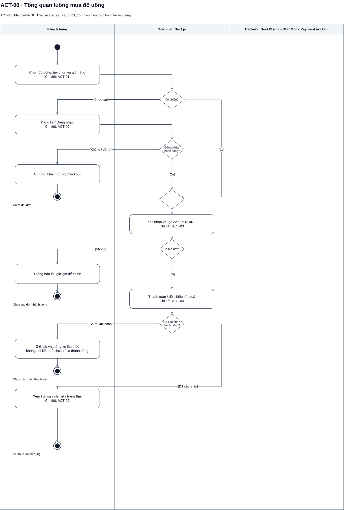

# Activity BrewLite — Task 2.1, Phú Lâm

## Căn cứ và loại mô hình

Đề Assignment 2 v1.0, Task 2.1; FR-01–FR-18/AC do Huy gửi; Use Case và Sequence trong Sơ đồ.docx của Trần Ân; code main `f119683`.

Đây là bộ mô hình nghiệp vụ để review SRS và luồng, không phải ảnh tạo bằng AI hoặc bằng chứng E2E. Đã dựng bằng native shape/connector, mở trong draw.io và xuất trực tiếp SVG/PNG bằng File → Export as. Nguồn chuẩn là `../activity-order.drawio` có 6 trang Activity. Các hình khớp từng trang; mã ACT là mã của sơ đồ, không thay mã UC/FR/NFR.

**Loại mô hình: thiết kế hành vi theo yêu cầu (to-be).** Cả sáu trang dùng cùng loại mô hình. Các chi tiết API trùng với hợp đồng đã kiểm tra; riêng khả năng đối chiếu FAILURE của đúng lần thử trong ACT-04 là điều kiện thiết kế an toàn, không được suy ra từ một trạng thái PAYMENT_FAILED cũ. Khoảng cách triển khai được tách sang bảng review, không đổi yêu cầu để hợp thức hóa lỗi code.

Bản v1.1 đã hoàn thành các mục bắt buộc của Task 2.1 trong phạm vi FR được cung cấp. Việc nhóm duyệt SRS/Use Case/Sequence và nghiệm thu runtime là công việc tích hợp riêng, không phải điều kiện để tự bỏ trống phần Activity.

## Danh mục

| Trang | Chức năng | FR | Ảnh |
|---|---|---|---|
| ACT-00 | Tổng quan menu → giỏ → xác thực → đơn → payment → history | FR-01–18 | [PNG](../png/activity-ACT-00.png), [SVG](../svg/activity-order.svg) |
| ACT-01 | Menu, lựa chọn size/topping/quantity, ước tính và giỏ | FR-01–05, FR-17 | [PNG](../png/activity-ACT-01.png), [SVG](../svg/activity-ACT-01.svg) |
| ACT-02 | Register/Login, phiên JWT và API bảo vệ | FR-06–07 | [PNG](../png/activity-ACT-02.png), [SVG](../svg/activity-ACT-02.svg) |
| ACT-03 | Định giá/snapshot, idempotency, giữ nguyên liệu và rollback | FR-07–12 | [PNG](../png/activity-ACT-03.png), [SVG](../svg/activity-ACT-03.svg) |
| ACT-04 | Mock Wallet/Card, failure/retry, đối chiếu kết quả chưa rõ | FR-13–14 | [PNG](../png/activity-ACT-04.png), [SVG](../svg/activity-ACT-04.svg) |
| ACT-05 | List/detail/status owner-scoped và cursor | FR-07, FR-09, FR-15–16, FR-18 | [PNG](../png/activity-ACT-05.png), [SVG](../svg/activity-ACT-05.svg) |

## Quy tắc đọc UML

- Chấm đen: initial node. Chấm đen có vòng ngoài: activity final, kết thúc **lần thực hiện được vẽ**, không đổi Order thành CANCELLED/COMPLETED.
- Action bo góc; tên là hành động. Hành động lớn ở ACT-00 dẫn chiếu trang chi tiết. Không thay call chức năng bằng quan hệ include/extend của Use Case.
- Diamond có >=2 luồng ra gắn guard trong `[...]`: decision. Diamond gom >=2 luồng vào, một luồng ra: merge, không phải join song song.
- Control flow nét liền có mũi tên mở. Chỗ đường giao có cầu nhảy không tạo nút nối; chỉ nối tại node/đầu mũi tên.
- Swimlane phân trách nhiệm Khách hàng, UI Next.js, Backend NestJS. Mock Payment và DB được gộp trong backend ở mức activity; Sequence mô tả lifeline và request/response chi tiết.
- Không dùng fork/join vì các bước trong luồng đang xét không phải các tác vụ song song độc lập. Concurrency nhiều khách được mô hình thành kiểm soát transaction/khóa và truy vết sang test kho.
- Các nhánh lỗi kết thúc lần thử hiện tại. Khi người dùng chọn Thử lại/chỉnh lựa chọn, bắt đầu lại thao tác tương ứng; không hiểu nút kết thúc là khách không thể thử lại. Nhánh Payment retry đã vẽ vòng lặp để thể hiện rõ chính sách key.
- ACT-01 decision “Có thể thêm giỏ?” = số lượng nguyên 1–99, có size nếu sản phẩm yêu cầu, và không vượt tồn khi đã có ước tính. Khi không đọc được ước tính, UI thông báo nhưng API vẫn là nơi kiểm tra tồn quyết định; không vẽ thành công giữ kho tại bước này.
- ACT-05 nhánh Xem thêm quay về merge trước bước tải danh sách; limit/cursor được kiểm tra lại. Hai nhánh chi tiết và chỉ đọc trạng thái tách riêng rồi merge trước final. Mọi GET đều read-only.

## Kiểm tra đã làm cho tạo phẩm

- Đối chiếu các nhánh nghiệp vụ với FR/AC và source, lập bảng khoảng cách thay vì tự sửa yêu cầu cho khớp code.
- Kiểm tra XML có 6 trang Activity; một initial mỗi trang, có final; các node nghiệp vụ reachable; decision có guard, merge có >=2 luồng vào/1 ra; không có action nhiều luồng vào ngầm thành join.
- Kiểm tra bounding box của action/decision không chồng nhau; mở và xuất các trang qua draw.io, kiểm tra PNG chữ/đường nối.
- Nhãn các node trong SVG khớp nguồn `.drawio`; đường connector đã kiểm tra không xuyên qua node không liên quan.
- Không chạy lại unit/E2E trong lần sửa tài liệu này; chỉ tham chiếu test hiện có trong `activity-traceability.md`. Không coi việc vẽ hình là kết quả test hệ thống.

## Cách mở và chỉnh

1. Mở draw.io → File → Open from → Device → `../activity-order.drawio`.
2. Chuyển giữa 6 tab ACT-00–ACT-05; zoom để đọc từng trang.
3. Sửa node/guard/connector trực tiếp. Giữ đường đi tránh cắt qua action/final; xuất lại cả ảnh liên quan sau khi đổi nguồn.
4. Export SVG và PNG ở Size=Diagram, nền trắng; không đổi đuôi HTML thành SVG. Nguồn `.drawio` là file chỉnh sửa chính thức.
5. Đổi FR/UC chỉ sau khi đồng bộ SRS. Bổ sung mapping NFR và UC chính thức khi nhận được, không đánh lại FR-01–FR-18 của Huy.

## Tài liệu liên quan

- [Bối cảnh và phạm vi](../../../requirements/task1.1/context-and-scope.md)
- [Đối chiếu và các điểm chưa khớp](activity-consistency-review.md)
- [Mapping FR/AC → Activity → Code/Test](activity-traceability.md)

## Quy tắc nghiệp vụ và tiêu chí kiểm tra

- [Hợp đồng luồng dùng chung](activity-flow-contract.md): điều kiện quyết định, bất biến, tiền/hậu điều kiện từng trang.
- [Mapping từng AC](activity-ac-coverage.md): dùng nguyên mã AC của Huy, phân biệt nhánh vẽ trực tiếp và quy tắc chi tiết của action.
- [Checklist và kết quả kiểm tra tạo phẩm](kiem-tra-luong-e2e.md).
