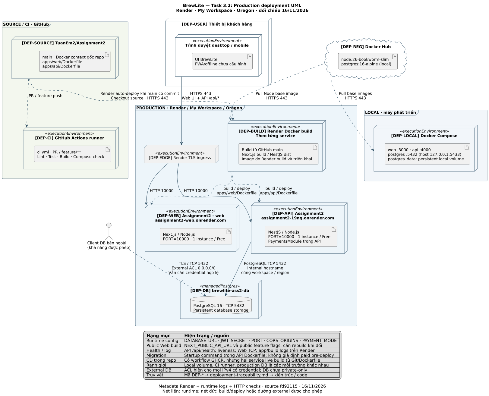

# Task 3.2 — UML deployment diagram

## 1. Phạm vi và căn cứ

Tài liệu mô tả **cấu hình triển khai trong repository Assignment 2**. Nền tảng đích là Render; source được đối chiếu lại tại commit `9715b33d079cf47c5be569bc132c19e0f8dea052`, ngày 16/11/2026.

Các URL Web/API production do chủ dự án cung cấp đã được kiểm tra HTTP; xem [bằng chứng production](deployment-evidence.md). Workspace được xác nhận là **My Workspace**. Nguồn build/deploy và kết nối database nội bộ đang chờ đối chiếu; region/gói dịch vụ và trạng thái bật PayOS chưa được xác minh qua Render. `DATABASE_URL` trong sơ đồ chỉ là tên cấu hình, không chứa giá trị bí mật.

File nguồn: [deployment-production.puml](deployment-production.puml). Sơ đồ dùng UML nodes, execution environments, artifacts, database và communication paths; luồng phát hành được tách bằng nét đứt.

Các mã node `DEP-*` được ánh xạ sang thành phần kiến trúc, Dockerfile/workflow và code cụ thể trong [bảng truy vết và kiểm tra tiêu chí nghiệm thu](deployment-traceability.md). Bộ sơ đồ và thuyết minh đặt trong `docs/diagrams/task3.2/`; kiến trúc/ADR đặt trong `docs/architecture/`.

## 2. Các node và artifact

| Ranh giới | Node | Artifact / vai trò |
| --- | --- | --- |
| Người dùng | Laptop/điện thoại | Trình duyệt tải Next.js và gọi API. PWA là định hướng; source chưa có manifest/service worker. |
| Local | Máy phát triển có Docker Engine/Compose | Chạy `web`, `api`, `postgres`; `.env` và named volume `postgres_data` chỉ thuộc local. |
| Source | GitHub `TuanEm2/Assignment2` | Source, Dockerfiles, schema/migrations và workflow. |
| CI/CD | GitHub Actions runner | CI lint/test/build; CD build/push image và gọi Render API khi phát hành. Không chạy ứng dụng production trên runner. |
| Registry | GHCR | `ghcr.io/tuanem2/assignment2-web:<SHA>` và `ghcr.io/tuanem2/assignment2-api:<SHA>`. |
| Production | Render Web Service — frontend | Chạy Next.js server từ image Web. Đây là dịch vụ phục vụ Next.js; source không định nghĩa thêm một CDN độc lập. |
| Production | Render Web Service — API | Chạy NestJS và các module nghiệp vụ, gồm mock payment. |
| Production | Render PostgreSQL | Lưu dữ liệu bền vững; API dùng kết nối nội bộ. Không dùng volume local Compose cho production. |
| Production | Render edge / vận hành | HTTPS ingress, health check và thu stdout/stderr; runtime env/secret cấp theo service. |

Backend và frontend là hai **Web Services** theo hợp đồng CD trong repo. API cần public HTTPS vì frontend trên trình duyệt gọi trực tiếp; không mô tả API thành private-only service. PostgreSQL nằm ở phía persistence nội bộ; trình duyệt không kết nối database.

Mock payment là module trong NestJS, không cần node/container thanh toán bên ngoài. Source có PayOS tùy cấu hình; sơ đồ cơ sở thể hiện mock mode như `.env.example`. Không suy ra chế độ production đã bật từ file mẫu này.

## 3. Giao thức và cổng

| Kết nối | Giao thức / cổng | Ghi chú |
| --- | --- | --- |
| Trình duyệt → frontend public origin | HTTPS 443 | `https://assignment2-web.onrender.com`; đã kiểm tra Web/menu HTTP 200. |
| Trình duyệt → API public origin | HTTPS 443 | `https://assignment2-19nq.onrender.com`, REST `/api/*`, JWT cho endpoint cần xác thực; health/catalog đã trả 200. |
| Render edge → Next.js | HTTP `PORT`; mặc định image là 3000 | Cổng bên trong dịch vụ, không phải public URL `:3000`. |
| Render edge → NestJS | HTTP `PORT`; source fallback 4000 | Render cấp `PORT`; ứng dụng đọc biến này. Cần ghi cổng thực tế khi đối chiếu dịch vụ. |
| API → PostgreSQL | PostgreSQL protocol TCP 5432, nội bộ | Dùng internal `DATABASE_URL`; thông tin TLS/SSL theo cấu hình database thực tế, chưa xác minh live. |
| GitHub Actions → GHCR | HTTPS 443 | Push/pull images; quyền `packages: write` chỉ cấp cho bước cần dùng. |
| GitHub Actions → Render API | HTTPS 443 | `scripts/cd/render-deploy.mjs` gửi yêu cầu deploy và đợi trạng thái. |
| Render → GHCR | HTTPS 443 | Pull image gắn full commit SHA; cần package public hoặc registry credential phù hợp. |
| Local host → Web / API / DB | 3000 / 4000 / 5433 | Bind `127.0.0.1` theo Compose; PostgreSQL trong Docker vẫn dùng 5432. |

Kết nối nội bộ PostgreSQL không đồng nghĩa có chứng nhận đã tắt external access; bước kiểm tra cấu hình database khi triển khai thật cần xác nhận riêng. Không đưa connection string có mật khẩu vào sơ đồ.

## 4. Luồng local, CI và production

### Local

`compose.yaml` khởi chạy PostgreSQL 16, API và Web. API đợi PostgreSQL healthy, chạy migration lúc khởi động theo mặc định Dockerfile; Web đợi API healthy. `postgres_data` giữ dữ liệu qua việc tạo lại container. `.env` được tạo từ `.env.example` và không commit lên Git.

### CI

`.github/workflows/ci.yml` chạy trên PR vào `main`, push `feature/**`, hoặc chạy thủ công. Pipeline cài dependency, generate/validate Prisma, lint, unit/contract tests, kiểm tra Compose và build cả API/Web. Database URL của CI là placeholder; pipeline hiện tại không chứng minh E2E trên PostgreSQL thật hoặc topology production.

### Production theo workflow CD

1. Tag `v*` hoặc chạy thủ công workflow CD; bước quality gate dùng lại CI.
2. Kiểm tra release SHA thuộc lịch sử `main`.
3. Build hai image `linux/amd64`, gắn full commit SHA và push GHCR. Public API URL được nhúng vào Web lúc build.
4. Bước deploy sử dụng GitHub Environment `production`, kiểm tra các biến/secret và cổng `RENDER_PREDEPLOY_READY`.
5. Gọi Render deploy API từ image đúng SHA; hợp đồng workflow yêu cầu migration qua pre-deploy đã được cấu hình trước.
6. Deploy frontend, sau đó chạy live HTTPS smoke test.

Workflow chỉ deploy các service đã tồn tại; không tự tạo database/service. File workflow hiện có chưa phải bằng chứng CD đã chạy thành công hay GitHub Environment đã có required reviewer.

## 5. Migration và persistent storage

Schema/migration nằm trong source và trong image API. Production theo hợp đồng CD cần cấu hình API Pre-Deploy Command `npm run db:migrate`, rồi đặt `RUN_MIGRATIONS_ON_STARTUP=false` để tránh chạy migration lại trong tiến trình app.

Render pre-deploy chỉ khả dụng trên gói dịch vụ hỗ trợ. Nếu chưa có pre-deploy hoặc dùng hình thức deploy khác, phải ghi lại cách chạy migration thực tế và điều chỉnh sơ đồ; không đặt `RENDER_PREDEPLOY_READY=true` chỉ để bỏ qua cổng kiểm tra.

Persistent storage thuộc PostgreSQL; frontend/API không cần persistent disk cho dữ liệu nghiệp vụ hiện tại. Backup/retention/restore không được cấu hình trong repo này, nên không ghi là đã có lịch backup cụ thể. Rollback image giữ nguyên database hiện tại và không tự đảo ngược migration.

## 6. Secrets và environment variables

| Nơi cấp | Tên biến / secret | Phạm vi |
| --- | --- | --- |
| GitHub Actions secret | `RENDER_API_KEY` | Cho workflow gọi Render API; không truyền ra frontend. |
| GitHub Actions token | `GITHUB_TOKEN` | Push GHCR trong workflow, `packages: write`. |
| GitHub Actions variables | `PRODUCTION_API_URL`, `PRODUCTION_WEB_URL`, `RENDER_API_SERVICE_ID`, `RENDER_WEB_SERVICE_ID`, `RENDER_PREDEPLOY_READY`, `PAYOS_FRONTEND_ENABLED` | Cấu hình release; bảo đảm giá trị thuộc đúng môi trường. |
| Render API runtime | `DATABASE_URL`, `JWT_SECRET`, `PORT`, `CORS_ORIGINS`, `PAYMENT_MODE`, `RUN_MIGRATIONS_ON_STARTUP` | Secret và config API; dùng internal DB URL. |
| Render API khi dùng PayOS | `PAYOS_ENABLED`, `PAYOS_CLIENT_ID`, `PAYOS_API_KEY`, `PAYOS_CHECKSUM_KEY`, `WEB_PUBLIC_URL` | Chỉ cấp khi bật tích hợp; sơ đồ không xác nhận đã bật. |
| Web build | `NEXT_PUBLIC_API_URL`, `NEXT_PUBLIC_MENU_DATA_SOURCE`, `NEXT_PUBLIC_PRODUCT_DETAIL_ENABLED`, `NEXT_PUBLIC_PAYOS_ENABLED` | Dữ liệu công khai trong bundle; đổi cấu hình phải rebuild. |

Sơ đồ và tài liệu chỉ chứa tên biến; không ghi giá trị secret. Nếu GHCR package private, Render cần quyền pull riêng; token push trong Actions không tự cấp quyền pull cho Render.

## 7. Health check và log

- API: `/api/health`, chỉ liveness; source trả JSON `status: ok`, service và timestamp.
- Local Compose: PostgreSQL dùng `pg_isready`; API dùng HTTP `/api/health`; Web có dependency vào API healthy. Compose chưa khai báo health check riêng cho Web.
- Render: cấu hình health check API `/api/health` theo hợp đồng deploy. Path/port đang bật trên service thật chưa được đọc trong phạm vi tài liệu này.
- Live smoke: kiểm tra HTTPS health, catalog, endpoint cần JWT và nội dung menu; không thay thế toàn bộ E2E checkout.
- Log: stdout/stderr của Next.js/NestJS và log build/deploy của GitHub Actions/Render. Source chưa có hệ thống log tập trung riêng, request ID thống nhất hay cảnh báo SLO.

## 8. Cách hoàn thiện bản phản ánh production thật

Theo đề bài, deployment diagram cuối cùng cần phản ánh nền tảng thực tế. Trước khi dùng bản này làm bằng chứng production, nhóm cần đối chiếu: hai service đúng Assignment 2; nguồn deploy thực sự là image hay Git/Dockerfile; domain, region, cổng; internal DB và storage; migration command; health path; quyền pull GHCR; cấu hình log/backup. Nếu service đang build trực tiếp từ Git, phải đổi đường phát hành trên sơ đồ cho đúng thay vì coi GHCR/CD là luồng đã hoạt động.

Phần kiểm tra source và HTTP công khai đã hoàn tất. Kết nối Render hiện tại không truy cập được **My Workspace** của Assignment 2; nguồn build/deploy và kết nối DB nội bộ đang chờ xác nhận như ghi trong [bằng chứng production](deployment-evidence.md). Điều kiện phản ánh nền tảng thực tế còn cần hoàn tất hai điểm này. Việc rà soát không triển khai, tạo hoặc sửa tài nguyên Render.

## 9. Nguồn đối chiếu

- `compose.yaml`, `apps/api/Dockerfile`, `apps/web/Dockerfile`.
- `.github/workflows/ci.yml`, `.github/workflows/cd.yml`.
- `scripts/cd/render-deploy.mjs`, `scripts/cd/validation.mjs`.
- `apps/api/src/main.ts`, `app.controller.ts`, `app.service.ts`.
- `.env.example`, `tests/smoke/production-smoke.mjs`.
- Tài liệu Render đã đọc ngày 15/11/2026: <https://render.com/docs/deploys.md>, <https://render.com/docs/health-checks.md>.
