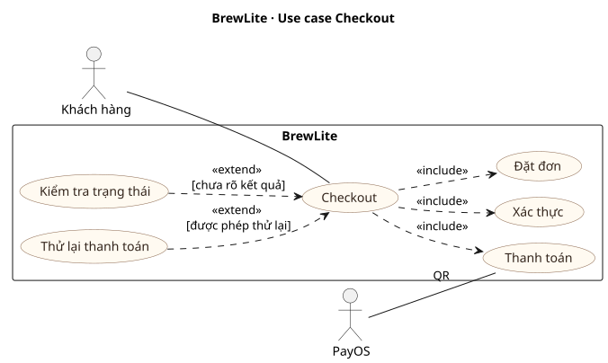

# Use case Checkout — Đặt và thanh toán đơn

| Mục | Đặc tả |
| --- | --- |
| Tác nhân chính | Khách hàng |
| Tác nhân hỗ trợ | PayOS, khi bật phương thức thanh toán QR |
| Kích hoạt | Khách mở Checkout từ giỏ, chọn phương thức và xác nhận thanh toán. |
| Tiền điều kiện | Khách đã đăng nhập. Giỏ có ít nhất một món. |
| Thành công | Đơn được lưu theo giá backend, nguyên liệu được giữ và có một khoản thanh toán thành công. Backend xác nhận đơn `PAID`. |
| Khi có lỗi | Lỗi tạo đơn hoàn tác thay đổi của giao dịch. Lỗi hoặc mất phản hồi khi thanh toán giữ giỏ và giữ mã đơn đã tạo để khách kiểm tra hoặc thử lại. |

## Luồng chính — Ví hoặc thẻ mô phỏng

1. Khách kiểm tra giỏ, chọn ví hoặc thẻ mô phỏng và bấm **Xác nhận thanh toán**. Checkout gọi `POST /api/orders` với JWT, `Idempotency-Key` và danh sách món, size, topping, số lượng. [FR-07, FR-08, FR-12]
2. Backend xác thực khách, kiểm tra dữ liệu và tìm đơn theo tài khoản, khóa và nội dung yêu cầu. Với yêu cầu mới, backend đọc giá từ catalog, tính tổng, lưu đơn `PENDING` và giữ nguyên liệu trong cùng giao dịch PostgreSQL. API trả mã đơn, tổng tiền và trạng thái. [FR-08–FR-12]
3. Checkout gọi `POST /api/payments/mock` với mã đơn, phương thức ví hoặc thẻ, kết quả mô phỏng và khóa thanh toán riêng. Backend lấy số tiền từ đơn đã lưu. [FR-13]
4. Khi thành công, backend lưu `Payment`, `PaymentAttempt` và chuyển đơn sang `PAID` trong cùng giao dịch. Checkout hiển thị mã đơn, tổng tiền backend và xóa giỏ sau khi nhận xác nhận. Khách có thể mở lịch sử để xem đơn. [FR-13–FR-16]

## Luồng thay thế và ngoại lệ

| Tình huống | Xử lý |
| --- | --- |
| Chưa đăng nhập hoặc phiên hết hạn | Checkout hướng khách tới đăng nhập. API bảo vệ đơn trả HTTP 401 nếu phiên không hợp lệ. [FR-07, FR-08] |
| Giỏ rỗng, dữ liệu sai hoặc món không tồn tại | Checkout chặn gửi giỏ rỗng. API trả HTTP 400 cho dữ liệu sai, HTTP 404 cho sản phẩm không tồn tại. [FR-05, FR-08] |
| Thiếu nguyên liệu hoặc công thức | API trả HTTP 409 khi thiếu nguyên liệu hoặc HTTP 503 khi thiếu công thức. Giao dịch tạo đơn được hoàn tác. [FR-10, FR-11] |
| Mất phản hồi tạo đơn | Trong cùng phiên Checkout với giỏ và phiên đăng nhập giữ nguyên, khách thử lại bằng cùng khóa đặt đơn. Nếu đã có đơn khớp nội dung, API trả đơn đó và giữ nguyên tồn kho. Nếu chưa có đơn, backend xử lý tạo đơn. Dùng lại khóa với nội dung khác trả HTTP 409. [FR-12] |
| Thanh toán mô phỏng trả thất bại | Backend lưu lần thử `FAILURE` và đặt hoặc giữ đơn ở `PAYMENT_FAILED`. Checkout giữ giỏ. Lần thử mới dùng lại khóa đặt đơn và dùng khóa thanh toán mới. [FR-13, FR-14] |
| Mất phản hồi thanh toán mô phỏng | Khách chọn **Kiểm tra trạng thái**. Checkout gọi `GET /api/payments/mock/status/:orderId`. Khi backend xác nhận đã thanh toán, giao diện hiển thị thành công. Nếu API trả `PENDING` hoặc `PAYMENT_FAILED`, giao diện cho thử lại. Nếu vẫn chưa đọc được kết quả, giữ trạng thái chưa rõ và giữ giỏ. [FR-14] |
| Gửi lại thanh toán | Cùng đơn, khóa và nội dung thì trả kết quả đã lưu. Dùng khóa mới cho đơn đã có khoản thanh toán thành công trả HTTP 409. [FR-13] |

## Luồng PayOS khi được bật

1. Khách chọn PayOS trên Checkout. Web tạo hoặc dùng lại đơn như luồng chính, rồi gửi `orderId` tới `POST /api/payments/payos/checkout`. Backend lấy số tiền từ đơn và trả liên kết chuyển tới PayOS.
2. Khách quét QR trên trang PayOS. Backend chỉ ghi nhận khoản thanh toán thành công sau khi kiểm tra chữ ký và dữ liệu webhook `POST /api/payments/payos/webhook`. Việc chuyển trang giữ giỏ nguyên vẹn.
3. Khi khách quay lại, web gọi `GET /api/payments/payos/status/:orderId`. Giao diện đọc kết quả từ backend và chỉ xóa giỏ tương ứng khi backend xác nhận `PAID`. Khi kết quả chưa được xác nhận, khách có thể kiểm tra lại.
4. Khi thử lại, backend kiểm tra liên kết cũ với PayOS. Liên kết còn chờ được dùng lại. Liên kết đã hủy hoặc hết hạn có thể được thay bằng liên kết mới. Nếu PayOS báo đang xử lý hoặc đã nhận tiền, Checkout yêu cầu kiểm tra trạng thái.

## Truy vết yêu cầu

| Mã từ [SRS](../task-1.2/srs-brewlite.md) | Hành vi kiểm thử | Nguồn kiểm thử |
| --- | --- | --- |
| FR-07, FR-08 | Xác thực phiên, tạo đơn đúng hợp đồng và đọc lại đơn chờ thanh toán | [Checkout Auth](../../../apps/web/src/app/checkout/checkout-auth.test.tsx), [History PostgreSQL](../../../apps/api/test/history-postgres.e2e-spec.ts) |
| FR-09–FR-12 | Tính và lưu giá, giữ kho cùng giao dịch, hoàn tác khi thiếu kho và gửi lại không tạo đơn trùng | [Orders PostgreSQL](../../../apps/api/test/orders-postgres.e2e-spec.ts), [Inventory PostgreSQL](../../../apps/api/test/inventory-postgres.e2e-spec.ts) |
| FR-13, FR-14, NFR-03 | Thanh toán mô phỏng, kiểm tra khi mất phản hồi, thử lại và khóa chống trả trùng | [Payment unit test](../../../apps/api/src/payments/payments.service.spec.ts), [Checkout Orchestrator](../../../apps/web/src/lib/checkout/checkout-orchestrator.test.ts) |
| FR-15, FR-16 | Xem đơn và giá đã lưu theo đúng tài khoản | [History PostgreSQL](../../../apps/api/test/history-postgres.e2e-spec.ts) |
