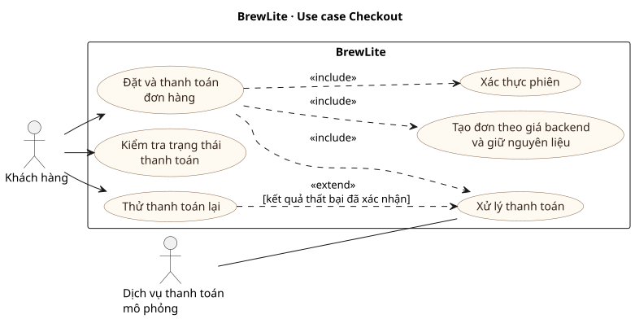

# UC Checkout · Đặt và thanh toán đơn BrewLite

| Mục | Đặc tả |
| --- | --- |
| Tác nhân chính | Khách hàng |
| Hệ thống hỗ trợ | Dịch vụ xác thực, lưu trữ đơn và tồn nguyên liệu, thanh toán mô phỏng |
| Kích hoạt | Khách chọn xác nhận thanh toán từ giỏ hàng |
| Tiền điều kiện | Khách có phiên hợp lệ và giỏ có ít nhất một dòng. Mỗi dòng gồm sản phẩm, size nếu có, topping và số lượng. |
| Hậu điều kiện thành công | Hệ thống lưu đơn và chi tiết món theo giá backend, ghi một khoản thanh toán thành công, trả mã đơn và tổng tiền. Checkout xóa giỏ sau khi xác nhận thành công. |
| Hậu điều kiện khi lỗi | Lỗi tạo đơn không để lại đơn hoặc thay đổi kho dở dang. Khi chưa xác nhận thanh toán thành công, khách vẫn có thể đối chiếu kết quả. |

## Luồng chính

1. Khách kiểm tra các món, số lượng và tổng tạm tính rồi chọn ví hoặc thẻ mô phỏng.
2. Hệ thống kiểm tra phiên và gửi yêu cầu tạo đơn với khóa chống tạo trùng. Backend lấy chủ đơn từ phiên và đọc giá từ catalog. Mỗi dòng lưu tên món, size, topping, đơn giá và thành tiền tại lúc đặt.
3. Backend tạo đơn `PENDING`, gọi giữ nguyên liệu và ghi số lượng giữ trong cùng transaction khi inventory đã được nối. Backend trả mã đơn và tổng tiền.
4. Checkout yêu cầu thanh toán cho mã đơn với khóa thanh toán riêng. Backend lấy số tiền từ đơn. Khi thành công, backend lưu `Payment` và `PaymentAttempt`, đồng thời chuyển đơn sang `PAID`.
5. Checkout hiển thị mã đơn và số tiền đã xác nhận, rồi xóa giỏ. Khách có thể theo dõi đơn trong lịch sử khi API lịch sử đã được nối.

## Luồng thay thế và ngoại lệ

| Tình huống | Hành vi dự kiến |
| --- | --- |
| Chưa đăng nhập hoặc phiên hết hạn | Yêu cầu đăng nhập rồi quay lại Checkout. API bảo vệ đơn bằng phiên xác thực. |
| Giỏ rỗng hoặc dữ liệu sai | Giỏ rỗng không thể gửi. API trả `400` khi dữ liệu lựa chọn sai, `404` nếu sản phẩm không còn tồn tại. Giỏ được giữ để khách chỉnh. |
| Thiếu nguyên liệu | Inventory từ chối giữ kho. Transaction hoàn tác đơn, các dòng và mọi thay đổi kho của yêu cầu. Giỏ được giữ để khách chỉnh. |
| Mất phản hồi khi tạo đơn | Gửi lại cùng nội dung và khóa tạo đơn để nhận lại đơn đã lưu. Cùng khóa với nội dung khác trả `409`. Nếu size đã đặt bị xóa khỏi catalog và mất UUID tham chiếu, backend cũng trả `409` vì không còn đủ dữ liệu xác minh. |
| Thanh toán thất bại có xác nhận | Đơn ở `PAYMENT_FAILED`, có một `PaymentAttempt` với kết quả `FAILURE`. Lần thử mới giữ mã đơn và dùng khóa thanh toán mới. Lần thử lại vẫn thất bại thì ghi thêm `PaymentAttempt` và giữ nguyên trạng thái đơn. |
| Kết quả thanh toán chưa rõ | Hiển thị **Kiểm tra trạng thái**. Gửi lại đúng yêu cầu thanh toán với cùng khóa chỉ để kiểm tra kết quả của lần đã gửi. Tạo khóa mới cho một lần thử mới sau khi xác nhận lần trước thất bại. |
| Đã thanh toán | Backend từ chối tạo khoản thanh toán thứ hai cho cùng đơn. Gửi lại đúng yêu cầu đã ghi nhận trả lại kết quả cũ. |

## Trạng thái và kiểm thử chấp nhận

`PENDING` là đơn đã tạo nhưng chưa thanh toán. `PAYMENT_FAILED` là đơn có lần thử thất bại. `PAID` là đã thanh toán. Nhân viên có thể tiếp tục theo quy tắc `PAID → PREPARING → READY → COMPLETED`. `CANCELLED` và `COMPLETED` là trạng thái kết thúc. Quyết định hoàn tiền và hoàn kho khi hủy cần chốt với TV1 và TV4.

| Mục truy vết tạm | Ca kiểm thử |
| --- | --- |
| Xác thực khách | Yêu cầu không có phiên hợp lệ không tạo đơn. |
| Đặt đơn và định giá | Tạo đơn có size/topping, đọc lại giá đã lưu và xác minh tổng dựa trên catalog. |
| Giữ nguyên liệu | Thử đơn không đủ kho và kiểm tra transaction không lưu dở dang. |
| Chống tạo trùng | Gửi đồng thời hai yêu cầu cùng khóa và nội dung, chỉ tạo một đơn. |
| Thanh toán và thử lại | Hai lần thất bại khác khóa lưu hai lần thử. Gửi lại khóa cũ không ghi trùng. Lần thử thành công chỉ ghi một khoản thanh toán. |
| Theo dõi đơn | Lần thử thành công chuyển `PAID`. Từ `PREPARING` cần qua `READY` trước khi hoàn tất. |

Các mục trên sẽ liên kết mã FR/NFR khi nhóm công bố SRS. Đây là đặc tả hành vi Checkout. Tình trạng kết nối inventory, thanh toán và điều phối giao diện được theo dõi trong [bàn giao TV3](../handoffs/TV3-sprint2-orders.md).
